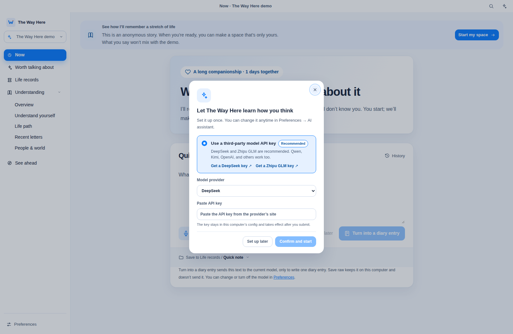
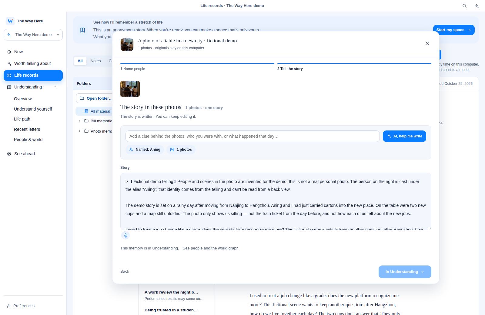
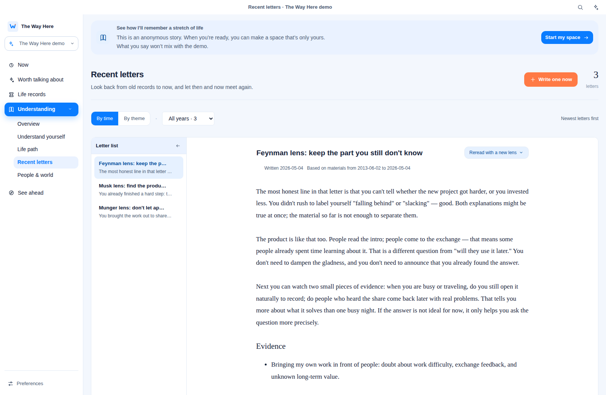

# The Way Here

English | [中文](README.md)

Tell it what's been happening lately, and it shapes your notes into a personal life archive that lives on your computer — one you can look back on and ask questions of.

> Over the past ten-plus years I've written more than 600 diary entries and taken tens of thousands of photos. Yet whenever I try to look back, all I find are a few blurry moments.

In English, the shell and the bundled demo are English — the demo shows as **The Way Here demo**, and window titles look like `Now · The Way Here demo`. Your own notes can stay Chinese. Switch with `desktop.locale` (`en` / `zh`).



[Install and run](#installation)

## What it does

**Jot down what's been happening.** Type in **Now** under **Quick note**, or just speak (recognized on-device, desktop only). Keep it raw with **Save raw, organize later**, or tap **Turn into a diary entry** and let it tidy things up.

**No diary that day? Start from photos.** On **Now**, tap **Find photos**, pick a set from your Mac Photos library and mark who's in them. It drafts the story behind them, and you edit before saving it into **Life records** (macOS desktop only).



**Look back and understand yourself.** **Understanding** organizes your records into a picture of who you are, the arc of your life, and the people and places in it. Want its take on how you've been lately? Ask for a letter in **Recent letters**. **See ahead** looks forward from what Understanding already knows. Something unclear? Keep asking in the panel on the right.



## Where your records live

Your data stays on your own computer. The server only listens on `127.0.0.1`.

When you save raw, both typing and speech stay on your machine. When you use **Turn into a diary entry**, chat, or ask for a letter, the relevant text is sent to the model you configured, for example through the `codex` CLI on your machine, or a provider you set up yourself.

Photos work the same way. Browsing in **Find photos** happens locally, and face detection and cropping run on-device. Only when you ask for a photo story are preview images of the selected photos sent, along with the names and text you entered, to your configured vision model.

## Installation

```bash
git clone https://github.com/lihaozheCharlie/the-way-here.git
cd the-way-here
bash start.sh
```

Requires Python 3.9+. The script sets up Node.js 22.19+ and pnpm, installs dependencies and builds. Then open http://127.0.0.1:4321; press Ctrl+C to stop. The first launch opens a bundled anonymous demo library, labeled **The Way Here demo** in English; create your own space from the top-left corner.

**Configure a model** (needed for diary entries, letters and chat): install and sign in to the Codex CLI, or open **Preferences** → **AI Assistant**, pick a provider and enter an API key, which is stored only on your machine. Photo stories need a model that can read images.

**Desktop app** (macOS only, includes voice input and photo memories):

```bash
cd studio && pnpm install && pnpm desktop
```

---

If this resonates with you even a little, a [Star](https://github.com/lihaozheCharlie/the-way-here) would mean a lot, or come to [Issues](https://github.com/lihaozheCharlie/the-way-here/issues) and tell me how you keep track of your life.
